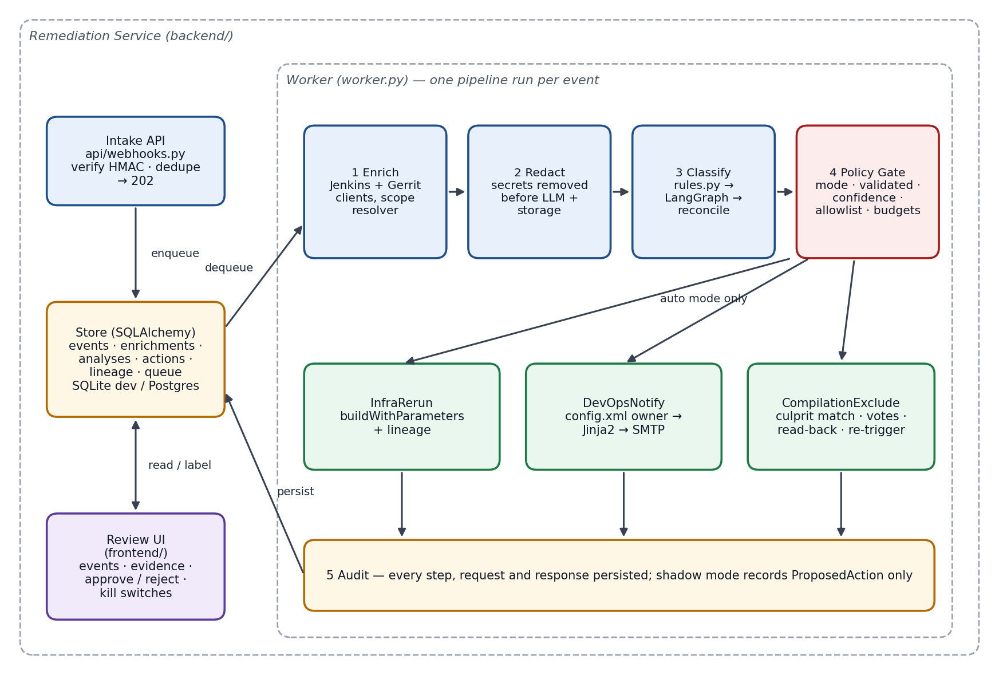

# Jenkins Failure Auto-Remediation — Solution Architecture

Status: **Draft for review** · Version 0.1 · 2026-10-31

Companion to: Design & Phased Plan (`docs/superpowers/specs/2026-10-30-jenkins-auto-remediation-design.md`)

## 1. Summary

**Recommendation:** Extend the existing Jenkins AI Analyzer into an event-driven remediation service. It receives Jenkins failures, classifies them with deterministic rules plus the existing LangGraph pipeline, and runs one of three bounded remediation workflows. Infra and DevOps remediation starts in shadow mode, where the service only records the action it would take, and moves to automatic execution once accuracy is proven. Compilation remediation (finding and excluding the culprit Gerrit change) runs automatically from go-live, with no human approval, behind an offline backtest and deterministic safeguards.

**Business impact:**
- Fewer manual touches per failed build.
- Faster recovery from transient infrastructure failures.
- Faster feedback to change authors.
- A complete audit trail for every automated decision.

**Architectural stance:** Validate before acting.
- Every action passes a policy gate.
- Every action target comes from system-of-record APIs, never from LLM output.
- Every step is persisted.

## 2. Scope

**In scope**
- Webhook intake from Jenkins.
- Enrichment from the Jenkins and Gerrit APIs.
- Classification into `infra`, `devops`, `compilation` or `needs_triage`.
- Three remediation workflows, the policy gate, the audit store and the review UI.

**Out of scope (v1)**
- Automated code or config fixes.
- Test-failure remediation.
- Changes to Jenkins or Gerrit beyond a shared-library failure hook and service-account permissions.

## 3. Architecture principles

| Principle | How it is applied |
|---|---|
| Validate before act | Policy gate requires validator pass, high confidence, rule agreement, eligibility and budget before any action |
| Deterministic targets | Change numbers, emails and job names come from Jenkins/Gerrit APIs; the LLM only proposes a category and evidence |
| Fail safe | Any uncertainty routes to `needs_triage`; no partial actions without read-back verification |
| Least privilege | Separate service accounts per system; shadow mode needs read-only credentials |
| Idempotent and bounded | Dedupe on `(controller_id, job, build#)`; re-run and re-trigger budgets enforced via lineage |
| Auditable | Every enrichment, analysis, gate decision, API request and response persisted with actor and timestamp |
| Reversible | Every Gerrit action is explained in a comment with restore instructions; re-runs never alter source |

## 4. System context


| External system | Interaction | Direction | Credential |
|---|---|---|---|
| Jenkins controller(s) | Failure webhook; console log, stage data, parameters, `config.xml`; re-run | In (webhook), Out (REST) | Jenkins user + API token (Read; Build on allowlisted jobs) |
| Gerrit | Change detail, files/diff, topic query; remove +2, post -1 and comment | Out (REST) | HTTP credentials; Code-Review -1..+1 and Remove Reviewer on target projects |
| SMTP relay | Owner notification and triage emails | Out | Send-only relay account |
| LLM provider | Redacted log excerpt in, structured classification out | Out | API key; egress allowlisted |
| Artifactory | Links extracted from logs; optional reachability check as infra signal | Out (optional) | Read-only or none |
| DevOps / build engineers | Review events, label shadow actions, operate kill switches | In (UI) | Identity provider TBD; interim local accounts |

## 5. Logical architecture



| Component | Responsibility | Notes |
|---|---|---|
| Intake API | Verify HMAC, dedupe, persist event, enqueue, return 202 | Stateless; no outbound calls on request path |
| Store | Events, enrichments, analyses, actions, lineage, queue | SQLAlchemy 2 + Alembic; SQLite (dev), PostgreSQL (prod) |
| Worker | Runs the pipeline per event: enrich → redact → classify → gate → execute → audit | DB-backed queue with row locking; 1..n replicas |
| Jenkins client | consoleText, `wfapi/describe`, `api/json` (params, causes), `config.xml`, `buildWithParameters`, queue-item resolution | Bounded log fetch (tail N MB) |
| Gerrit client | Change detail, files/diff, topic query, delete vote, post review | Strips `)]}'` XSSI prefix; uses `/a/` authenticated endpoints |
| Build-scope resolver | Determines change(s) in a build: Gerrit Trigger params → batch param/manifest → configured query | Unresolved → `needs_triage` |
| Rules engine | Deterministic signatures + failing stage → category hint | Versioned rule set; seeded from known infra/devops/compiler patterns |
| LangGraph classifier | Existing parser → error detector → root cause → validator loop, hardened | Schema-validated JSON, 4-class taxonomy, exposes `validated` |
| Policy gate | Mode, validation, confidence, agreement, allowlist, budgets, kill switch | Single decision point; emits reason codes |
| Executors | InfraRerun, DevOpsNotify, CompilationExclude | Idempotent; staleness re-check before acting |
| Review UI | Event list, evidence, proposed/executed actions, approve/reject labels, kill switches | Extends current static frontend |

## 6. Processing pipeline

| Stage | Input | Output | Failure handling |
|---|---|---|---|
| 1. Intake | Webhook payload + signature | `event` row, queue entry | Bad signature → 401; duplicate → 200 with existing id |
| 2. Enrich | Event | Log tail, failing stage, params, causes, Artifactory links, Gerrit change set | Retry with backoff; persistent failure → `needs_triage` (reason: enrichment_failed) |
| 3. Redact | Raw log excerpt | Redacted excerpt | Redaction is mandatory; on error the event stops (no LLM call) |
| 4. Classify | Redacted excerpt, stage, rule hints | Category, confidence, validated, evidence | LLM error/timeout → rules-only result, forced to `needs_triage` unless rules are decisive and category mode allows |
| 5. Gate | Analysis + context | Allow / deny + reason codes | Deny → `needs_triage` |
| 6. Execute | Gate allow | Action record with request/response | Executor error → action `failed`; no automatic retry of write calls without idempotency check |
| 7. Audit | All of the above | Immutable records; UI visibility | — |

## 7. Classification and decision flow


| Gate check | Pass condition | Reason code on fail |
|---|---|---|
| Validator | LangGraph validator returned `valid = true` within retry budget | `unvalidated` |
| Confidence | Confidence = `high` | `low_confidence` |
| Agreement | Rule hint equals LLM category, or no rule matched | `rule_llm_conflict` |
| Eligibility | Job matches controller allowlist; budget for lineage not exhausted | `job_not_allowed` / `budget_exhausted` |
| Targets | Owner email found and on allowed domain; culprit change resolved uniquely | `target_unresolved` / `culprit_ambiguous` |
| Mode | Category mode is `shadow` (record) or `auto` (execute); `off` records analysis only | `mode_off` |
| Kill switch | Global and category switches off | `kill_switch` |

## 8. Remediation workflows

### 8.1 Infra — re-run

| Step | Operation | Guardrail |
|---|---|---|
| 1 | `GET {build_url}api/json?tree=actions[parameters[name,value],causes[*]]` | — |
| 2 | Check lineage budget (default ≤1 automatic re-run per original build) | Exhausted → `needs_triage` |
| 3 | Staleness check: failed build is still the latest for its job | Newer build exists → skip |
| 4 | `POST {job_url}buildWithParameters` with original parameters | Allowlisted jobs only |
| 5 | Follow `Location` queue item → `executable.number`; write lineage | Unresolved after timeout → action `failed`, alert |

### 8.2 DevOps — notify owner

| Step | Operation | Guardrail |
|---|---|---|
| 1 | `GET {job_url}config.xml`; extract owner via configured XPath | XML parsed with a hardened parser (no external entities) |
| 2 | Validate email format and allowed domain | Invalid/missing → `needs_triage` |
| 3 | Rate-limit per (job, failure signature) per N hours | Suppressed sends recorded |
| 4 | Render Jinja2 template (job, build link, failing stage, evidence, analysis) | Template autoescaping on |
| 5 | Send via SMTP relay; record message id | Send failure → action `failed` |

### 8.3 Compilation — exclude culprit and re-trigger

| Step | Operation | Guardrail |
|---|---|---|
| 1 | Resolve change set via build-scope resolver | Unresolved → `needs_triage` |
| 2 | For each change: `GET /a/changes/{id}?o=CURRENT_REVISION&o=DETAILED_LABELS&o=DETAILED_ACCOUNTS`, `GET .../revisions/current/files` | Patchset must equal the one built |
| 3 | Culprit match: compiler-error file paths ∩ files modified by each change | Zero or multiple matches → `needs_triage` |
| 4 | Topic expansion: `GET /a/changes/?q=topic:{topic}+status:open` | Whole topic leaves the batch together |
| 5 | Culprit: `DELETE /a/changes/{id}/reviewers/{account}/votes/Code-Review` per +2; `POST .../revisions/current/review` with `Code-Review: -1` and evidence comment | Comment includes build link and restore steps |
| 6 | Topic siblings: remove +2 only (no -1); comment "held back: topic sibling failed" | No negative vote on non-culprits |
| 7 | Read-back: no +2 remains on any change in the unit | Mismatch → stop, alert |
| 8 | Re-trigger only for query-defined batch builds; budget ≤2 cycles per pipeline run | Single-change and parameter/manifest batches: vote + comment only |
| 9 | Post-action: sampled exclusions queued for DevOps audit review (after the fact, not an approval); one-click restore removes bot -1 and asks reviewers to re-apply +2 | Confirmed wrong-culprit vote trips the compilation kill switch |

All steps run automatically with no human approval. Execution is limited to an allowlist of Gerrit projects at go-live.

## 9. Data architecture

| Entity | Key fields | Purpose |
|---|---|---|
| `events` | id, controller_id, job, build_number, build_url, received_at, status | One per failed build; unique on (controller_id, job, build_number) |
| `enrichments` | event_id, failing_stage, params, causes, artifactory_links, gerrit_changes, log_excerpt (redacted) | Inputs used for classification |
| `analyses` | event_id, rule_hint, llm_output, category, confidence, validated, evidence, model, prompt_version, rules_version | Reproducible classification record |
| `gate_decisions` | analysis_id, allowed, reason_codes, mode | Why an action was or was not taken |
| `actions` | id, event_id, type, mode, status, target, request, response, actor, created_at, executed_at | Proposed and executed actions |
| `labels` | action_id, reviewer, verdict, note | Shadow-mode ground truth for promotion |
| `lineage` | parent_event_id, child_build_url, kind (rerun/retrigger) | Budget enforcement and loop prevention |

**Action states**
- Shadow: `proposed` → `approved` / `rejected`. These are labels only; nothing executes.
- Auto: `pending` → `executed` / `failed` / `skipped` (stale, budget exhausted or kill switch).

**Retention (proposed)**
- Redacted log excerpts: 90 days.
- Analyses, decisions, actions and labels: 1 year.
- Raw logs are never stored.

## 10. Integration contracts

### 10.1 Webhook (Jenkins → service)

```
POST /webhooks/jenkins
X-Remediation-Timestamp: 2026-10-30T14:02:11Z
X-Remediation-Signature: sha256=<hex HMAC of timestamp + "." + body>

{
  "controller_id": "jenkins-prod-1",
  "job": "folder/app-build",
  "build_number": 1234,
  "build_url": "https://jenkins.example.internal/job/folder/job/app-build/1234/",
  "result": "FAILURE"
}
```

Responses:
- `202` with `event_id` when accepted.
- `200` with the existing `event_id` for a duplicate.
- `401` for a bad signature or a timestamp more than 5 minutes off.

### 10.2 Service internal API (UI)

| Endpoint | Purpose |
|---|---|
| `GET /events?status=&category=` | Event list |
| `GET /events/{id}` | Event detail: enrichment, analysis, gate decision, actions |
| `POST /actions/{id}/label` | Approve/reject a shadow action |
| `GET/PUT /settings/modes` | Per-category mode and kill switches (privileged role) |
| `POST /analyze-log` | Existing manual upload path, retained |

## 11. Security architecture

| Concern | Control |
|---|---|
| Webhook spoofing | HMAC-SHA256 with per-controller secret; timestamp window; TLS |
| Prompt injection via logs | LLM output limited to category/evidence/explanation; targets from APIs; evidence must be verbatim substrings; policy gate independent of LLM text |
| Secret leakage | Redaction before LLM and storage; structured logging replaces `print`; no raw log persistence |
| Data sent to third-party LLM | Redacted excerpts only; provider approval pending (open decision) |
| Credential scope | Separate service accounts; infra/devops shadow phases run with read-only Jenkins credentials; Gerrit write (Code-Review -1..+1, Remove Reviewer) needed from compilation go-live, limited to allowlisted projects |
| UI access | Pluggable auth; role split: viewer, labeler, operator (modes and kill switches) |
| XML parsing | Hardened parser for `config.xml` (no external entities) |
| Email injection | Recipients only from validated config field and allowed domains; template autoescaping |

## 12. Deployment view


**Containers**
- `remediation-api`: FastAPI, which also serves the review UI.
- `remediation-worker`: 1..n replicas.
- PostgreSQL.

**Networking**
- Inbound: Jenkins → API (HTTPS).
- Outbound from the worker: Jenkins, Gerrit, SMTP and the LLM provider, all through egress allowlisting.

**Configuration**
- `pydantic-settings` reads from environment variables and a secrets store.
- Each controller has its own block: URL, credentials, HMAC secret and allowlist.

**Hosting target:** VM or Kubernetes, still to be decided. The containers are the same either way.

## 13. Reliability and failure modes

| Failure | Effect | Mitigation |
|---|---|---|
| Duplicate or replayed webhook | Double processing | Unique dedupe key; timestamp window |
| Worker crash mid-pipeline | Event stuck | Lease with timeout; event re-queued; executors idempotent (check lineage/votes before write) |
| Jenkins API unavailable | No enrichment / re-run | Retry with backoff; then `needs_triage` |
| Gerrit partial update (some votes removed) | Inconsistent exclusion | Read-back step; stop and alert; no re-trigger until consistent |
| LLM timeout or malformed output | No LLM classification | Schema validation + retry; fallback to rules-only → `needs_triage` |
| Re-run fails again | Loop risk | Lineage budget; second infra failure → `needs_triage` + notify |
| New patchset uploaded before action | Acting on stale change | Patchset staleness check before every Gerrit write |
| Wrong culprit voted automatically | Developer change blocked incorrectly | Unique-match rule; backtest go-live bar; one-click restore; audit sampling; confirmed wrong vote trips compilation kill switch |
| Failure storm (agent pool outage) | Mass re-runs | Global rate limit on re-runs; circuit breaker trips kill switch above threshold |

## 14. Observability

**Metrics**
- Events received and processed.
- Category mix.
- Gate denials, broken down by reason code.
- Actions proposed, executed and failed.
- Label agreement rate per category.
- Queue depth.
- Time from webhook to decision.

**Logs:** structured JSON with `event_id` correlation and secrets redacted.

**Alerts**
- Worker backlog above threshold.
- Executor failure rate.
- Read-back mismatch.
- Circuit breaker trip.
- LLM error rate.

## 15. Rollout and operating modes

| Mode | Behavior | Credentials needed |
|---|---|---|
| `off` | Analysis recorded; no action proposed | Read-only |
| `shadow` | Proposed action recorded; reviewers label it | Read-only |
| `auto` | Gate-approved actions execute | Write (scoped) |

**Default modes at go-live:** infra and devops start in `shadow`; compilation starts in `auto` (no human approval).

**Compilation go-live bar (replaces the shadow period):**
- Offline backtest of classifier + culprit matcher on historical failed builds with a known culprit, labeled by DevOps.
- Zero wrong-culprit identifications in the backtest.
- Gerrit write permissions granted; initial project allowlist agreed.

**Promotion for infra and devops (proposed thresholds):**
- At least 50 labeled shadow events.
- At least 95% approved by reviewers.
- Zero wrong-target incidents.

**Rollout order:** infra → devops → compilation. Compilation goes live directly in `auto` once its backtest passes, starting with allowlisted Gerrit projects.

## 16. Changes to the existing codebase

| Area | Current | Target |
|---|---|---|
| `graph.py` | 3-category taxonomy; unvalidated output returned; bare `json.loads` | 4-class taxonomy; `validated` exposed; schema-validated output with retry |
| `main.py` | Upload endpoints only; sync LLM call in async route; duplicate Groq client | Webhook + UI API routers; LLM work in worker; single configured client |
| `models.py` | Response `Literal` of 3 categories | Shared enums for category, action type, status |
| Logging | `print` of full logs | Structured, redacted logging |
| Config | `GROQ_API_KEY` only; hardcoded model and URLs | `settings.py` (controllers, Gerrit, SMTP, LLM, modes, thresholds) |
| Persistence | None | SQLAlchemy store + migrations |
| Frontend | Single upload page | Upload page + event list/detail + labeling + settings |

## 17. Open architectural decisions

| # | Decision | Owner | Needed by |
|---|---|---|---|
| 1 | Build-scope mechanism actually used by the pipelines | Jenkins admin | P4 |
| 2 | Owner field location in job `config.xml` | DevOps | P3 |
| 3 | Gerrit service-account permissions | Gerrit admin | P4 |
| 4 | LLM provider approval for build-log content | Security / data governance | P1 production use |
| 5 | Hosting target and identity provider | Platform team | Before production |
| 6 | SMTP relay, sender identity, template wording | DevOps | P3 |
| 7 | Re-run allowlist contents | DevOps | P2 |
| 8 | Promotion thresholds | DevOps lead | P2 |
| 9 | Compilation go-live scope: initial Gerrit project allowlist, backtest sample size, audit sampling rate | DevOps lead + Gerrit admin | P4 |
