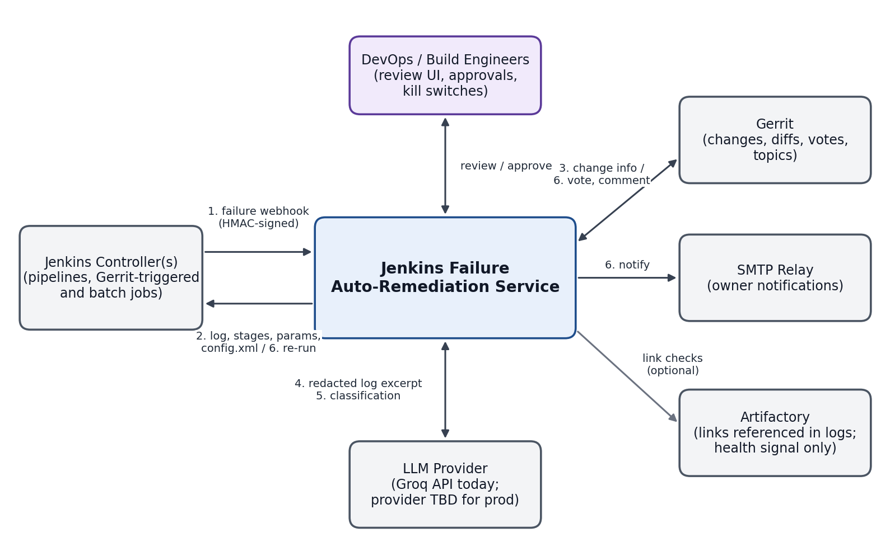
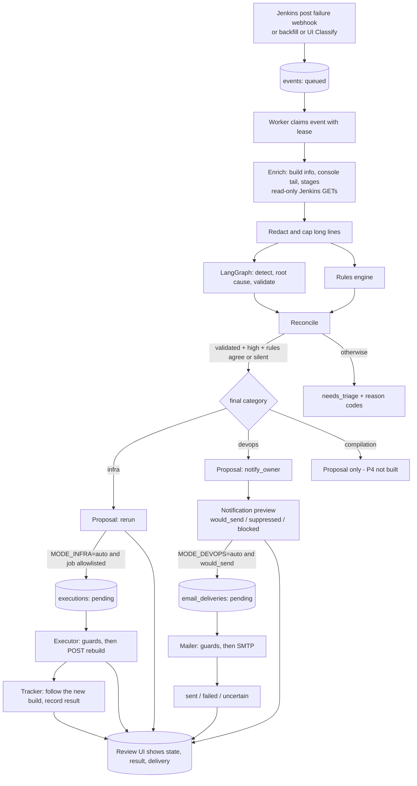
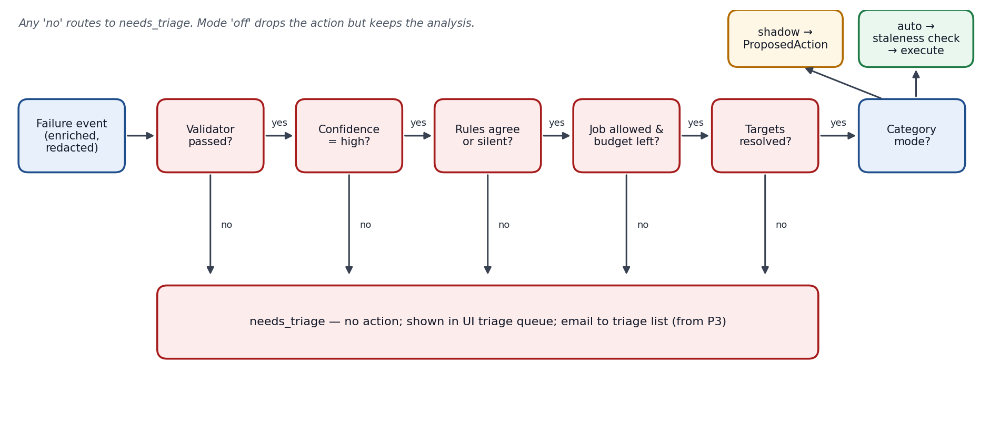
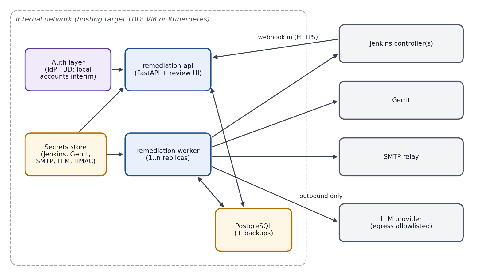

# Jenkins Failure Auto-Remediation — Solution Architecture

Status: **Draft for review** · Version 0.2 · 2026-11-01 (as built through P3; v0.1 was the pre-implementation design)

Companion documents:
- Design & Phased Plan: `docs/superpowers/specs/2026-10-30-jenkins-auto-remediation-design.md`
- User & Tester Guide: `docs/user-guide/user-and-tester-guide.md`

> **How to read this version.** Sections 1–17 keep the v0.1 structure. Where the implementation differs from the original design, the text describes what is **built**, and section 1.2 lists every deliberate difference. The four diagrams in `diagrams/` show the original design: they pre-date the remediation executor, the mail sender and the rebuild tracker, which are shown in the diagram in section 6.

## 1. Summary

**Recommendation:** Operate the Jenkins AI Analyzer as an event-driven remediation service. It receives Jenkins failures (webhook, backfill or an operator's click), classifies them with deterministic rules plus a hardened LangGraph pipeline, and runs bounded remediation workflows. Every category starts in **shadow mode**, where the service only records the action it would take, and moves to automatic execution per category once accuracy is proven.

**Business impact:**
- Fewer manual touches per failed build.
- Faster recovery from transient infrastructure failures.
- Faster feedback to the people who own a failing job.
- A complete audit trail for every automated decision.

**Architectural stance:** validate before acting.
- Every action passes explicit guards, and every guard failure is recorded with a reason code.
- Every action target comes from system-of-record APIs or operator configuration, never from LLM output.
- Every step is persisted.
- **Anything uncertain is parked, not retried:** a write whose outcome is unknown is never repeated automatically.

### 1.1 Implementation status

| Phase | Scope | Status |
|---|---|---|
| P0 Harden | Schema-validated LLM output, `validated` flag, 4-class taxonomy, settings, structured redacted logging | **Done** |
| P1 Intake + shadow classify | Webhook, backfill, queue + worker, Jenkins read client, rules, reconcile, review UI, labels, accuracy metric | **Done** |
| P1+ Browse & classify | List every failing job on the controller (age filter, search, paging), classify one or many from the UI, live status | **Done** |
| P2 Infra re-run | Rebuild executor with guards, lineage budget, kill switch, rebuild-result tracking | **Built and tested against a fake Jenkins; one real rebuild validated manually. Default `shadow`; no production `auto` run yet** |
| P3 DevOps notify | Owner resolution, rendered preview, rate limit, recipient feedback, SMTP sender with delivery tracking | **Preview in production use (shadow). Sender built and tested against a local SMTP server; never run against a real relay. Default `shadow`** |
| P4 Compilation + Gerrit | Culprit matching, votes, re-trigger | **Not started.** Compilation failures get a proposal record only |
| P5 Operate | Metrics, alerting, runbook | **Partial:** accuracy and notification metrics, kill switch. No alerting yet |

### 1.2 Deliberate differences from the v0.1 design

| Topic | v0.1 design | As built | Why |
|---|---|---|---|
| Webhook authentication | HMAC-SHA256 with timestamp window | Shared secret in `X-Webhook-Token`, plus canonical `build_url` and `controller_id` binding | Simplest control that Jenkins `post{failure}` snippets can use; HMAC remains a hardening option |
| Policy gate | One component | Three layers: `reconcile` (classification), `policy.propose_action` (what to propose), and each executor's own guards at the moment of acting | The moment of acting is when the world may have changed (new build, kill switch, mode change) |
| Action storage | `actions`, `gate_decisions`, `lineage` | `proposed_actions`, `executions`, `rebuild_outcomes`, `notifications`, `email_deliveries`; lineage is `executions.root_event_id` | Each action type has different states; separate tables avoid altering existing databases |
| Mail template | Jinja2 | Plain-text template in code, redacted and size-capped | No HTML, so no injection surface |
| Migrations | Alembic | `create_all`; new tables appear automatically, existing tables are never altered | Acceptable until PostgreSQL; new state is always added as a new table |
| Review UI | Extends the static frontend | A separate authenticated UI served at `/ui/`; the original upload page is retained but unused | Needs auth and role-aware controls |
| Per-category mode | Settings page | Environment settings (`MODE_INFRA`, `MODE_DEVOPS`) plus a runtime kill switch | Mode changes are deliberate deployments, stopping is immediate |

## 2. Scope

**In scope**
- Webhook, backfill and manual intake of failed builds.
- Enrichment from the Jenkins API (Gerrit enrichment is limited to build parameters).
- Classification into `infra`, `devops`, `compilation` or `needs_triage`.
- Remediation: infra re-run (P2), devops owner email (P3), review UI, audit store.

**Out of scope (v1)**
- Automated code or config fixes.
- Test-failure remediation.
- Compilation culprit exclusion in Gerrit (P4, designed but not built).
- Changes to Jenkins beyond an optional shared-library failure hook and service-account permissions.

## 3. Architecture principles

| Principle | How it is applied |
|---|---|
| Validate before act | A classification acts only if validated, `high` confidence and not contradicted by a rule; every executor re-checks its own guards at execution time |
| Deterministic targets | Job names, build numbers and parameters come from Jenkins; recipients come from operator configuration; the LLM only proposes a category, evidence and advisory text |
| Fail safe | Any uncertainty routes to `needs_triage` or a parked state (`uncertain`); never a blind retry |
| Least privilege | Read-only Jenkins client by default; a separate write-capable client exists only for the executor and can POST to exactly two endpoints |
| Idempotent and bounded | Dedupe on `(controller_id, job, build_number)`; re-run budget per lineage and per job; one email per (job, failure signature) per window |
| Auditable | Every enrichment, analysis, proposal, execution and delivery is a persisted row with timestamps and reason codes |
| Reversible / stoppable | Kill switch (setting or runtime) stops every executor and the mailer; re-runs never alter source |
| Honest UI | The UI states what is actually happening (mode banner, "not sent", "uncertain") and never claims an action it did not perform |

## 4. System context



| External system | Interaction | Direction | Credential |
|---|---|---|---|
| Jenkins controller(s) | Failure webhook; console log, stage data, parameters, `config.xml`, job list; **rebuild** (`build` / `buildWithParameters`) | In (webhook), Out (REST) | Jenkins user + API token: Read; **Build on allowlisted jobs only when `MODE_INFRA=auto`** |
| Gerrit | Change detail, files, votes (P4) | Out | Not used yet |
| SMTP server | Owner notification | Out | Sender mailbox + SMTP password. For Gmail an **App Password**; a corporate relay may need none |
| LLM provider (Groq) | Redacted log excerpt in, structured classification out | Out | API key; egress allowlisted |
| DevOps / build engineers / testers | Browse failures, classify, review, label, operate the kill switch | In (UI) | HTTP Basic, local accounts (`viewer`, `labeler`, `operator`) |

## 5. Logical architecture

| Component | Responsibility | Notes |
|---|---|---|
| Intake API (`api/webhooks.py`) | Verify token, bind URL and controller, dedupe, persist, return 202 | No outbound calls on the request path |
| Review API (`api/review.py`) and UI (`api/ui.py`, `static/review/`) | Browse live failing jobs, classify, event list/detail, labels, metrics, controls | HTTP Basic with role check on every route |
| Store (`store/`) | SQLAlchemy 2; SQLite by default, PostgreSQL later | `create_all`; see section 9 |
| Worker (`worker.py`) | One loop: process events → run executor → run mailer → track rebuilds | DB-backed queue with leases and fencing; `python -m worker` |
| Pipeline (`pipeline.py`) | Per event: enrich → classify → rules → reconcile → propose → (queue execution / email) | One DB transaction; a preview bug is logged, never fails the event |
| Jenkins client (`clients/jenkins.py`) | Reads (console, `wfapi`, build info, job list, queue items, run status); optional guarded write | Redirects are errors; every URL scoped to the configured base |
| Rules engine (`classification/rules.py`) | Deterministic signatures → category hint | Skips shell trace lines; compile markers case-sensitive; versioned |
| LangGraph classifier (`graph.py`, `llm.py`) | Parser → error detector → root cause → validator, with retry | Per-agent models, reasoning effort and rate-limit handling are configurable; merged-agent and fix-advisory variants exist but are **off** |
| Reconcile (`classification/reconcile.py`) | Combine LLM result and rule matches into the final category | Reason codes explain every `needs_triage` |
| Policy (`policy.py`) | What would be done for a final category | Records proposals only |
| Executor (`executor.py`) | Infra re-run with guards; read-only rebuild-result tracking | The only writer to Jenkins |
| Owners / notify (`owners.py`, `notify.py`) | Who to email, what the message says, rate limit | Recipient sources never scrape config text |
| Mailer (`mailer.py`) | SMTP delivery with a state machine | The only module that imports an email library |
| Benchmark (`eval/benchmark.py`) | Compare LLM configurations on a labeled set | Reads gitignored `eval-data/`; harness only |

## 6. Processing pipeline



| Stage | Input | Output | Failure handling |
|---|---|---|---|
| 1. Intake | Webhook, backfill row or UI click | `events` row, `queued` | Bad token → 401; duplicate → existing event; build not found / not failed (UI) → 422 |
| 2. Enrich | Event | Console tail, failing stage, parameters (redacted names), causes | Retry with backoff; after `worker_max_attempts` → `failed` |
| 3. Redact | Raw excerpt | Redacted excerpt | Mandatory; raw logs are never stored |
| 4. Classify | Redacted excerpt | Category, evidence, confidence, `validated` | Unusable output → `needs_triage`; provider outage → event retried |
| 5. Reconcile | Analysis + rule matches | Final category + reason codes | Anything contradictory → `needs_triage` |
| 6. Propose | Final category | `proposed_actions` row (allowed or denied with reason) | None |
| 7. Execute / send | Pending execution or delivery | State machine row | Guards re-checked at the moment of acting; ambiguous outcome → `uncertain`, never retried |
| 8. Track | Triggered executions | `rebuild_outcomes` | Read-only; transient errors keep the last state |

## 7. Classification and decision flow



**Classification gate (`reconcile`).** The LLM category becomes final only if all hold.

| Check | Pass condition | Reason code on fail |
|---|---|---|
| Validator | `validated = true` (deterministic evidence grounding **and** the validator agent) | `unvalidated` |
| Confidence | `high` | `low_confidence` |
| Rule ambiguity | Rules matching more than one category | `rule_ambiguous` |
| Rule agreement | A matching rule's category equals the LLM category, or no rule matched | `rule_llm_conflict` |

**Action guards (at the moment of acting).** Infra re-run, in order:

| Guard | Skip reason |
|---|---|
| Kill switch (setting or runtime toggle) | `kill_switch` |
| `MODE_INFRA` is `auto` | `mode_not_auto` |
| Job matches `RERUN_JOB_ALLOWLIST` (empty allows nothing) | `job_not_allowed` |
| Re-runs in this lineage below `RERUN_BUDGET` | `budget_exhausted` |
| Live re-runs of this job in the window below the budget | `job_rate_limited` |
| The failed build is still the job's latest build | `stale_build` |
| The build is still `FAILURE` | `build_not_failed` |
| No secret (password) parameter | `secret_parameters` |

DevOps email, in order: preview decision `would_send` (valid recipients, within rate limit, kill switch off) → at send time the kill switch, `MODE_DEVOPS=auto`, decision and recipients are re-checked (`kill_switch`, `mode_not_auto`, `not_sendable`, `no_recipients`).

## 8. Remediation workflows

### 8.1 Infra — re-run (built)

| Step | Operation | Guardrail |
|---|---|---|
| 1 | Pipeline records a `rerun` proposal (job, build URL, parameter *names*) and, only in `auto` for an allowlisted job, an `executions` row `pending` | Stored parameters are redacted; values are re-read at execution |
| 2 | Executor claims it (`claimed`) and runs the guards in section 7 | Any failed guard → `skipped` with a reason; nothing is sent |
| 3 | Live checks: latest build, still failed, parameters readable | Jenkins error before the write → `failed` (nothing sent) |
| 4 | Persist the intent (`triggering`), then `POST {job}buildWithParameters` (or `build` if parameterless) with the original parameters; a crumb is sent only if Jenkins offers one | The write client may POST to exactly these two paths |
| 5 | Follow the `Location` queue item to the new build number | Unresolved in time → still `triggered`, resolved later by the tracker |
| 6 | **Tracker** (every worker loop, read-only) records `queued → running → finished` with Jenkins' own result, or `cancelled` / `unknown` | Re-checked at most every 20 s; abandoned as `unknown` after 24 h; finds the build by `queueId` if Jenkins forgot the queue item |

Terminal states: `triggered`, `skipped`, `failed`, `uncertain`. **`uncertain`** means the request may have been applied (transport failure after sending, or a crash around the POST); it is never retried.

### 8.2 DevOps — notify owner (built; sender untested on a real relay)

| Step | Operation | Guardrail |
|---|---|---|
| 1 | Resolve recipients, first source wins: `OWNER_MAP` (job pattern → addresses) → default of the parameter named `OWNER_PARAMETER_NAME` in `config.xml` → `EMAIL_ID` (test recipient) | An explicit source that is invalid is blocked, never replaced by a later one |
| 2 | Validate: address syntax (no whitespace or control characters), `ALLOWED_EMAIL_DOMAINS` (not applied to the `EMAIL_ID` override), at most 3 recipients, whole list blocked if any entry is bad | Header injection cannot match |
| 3 | Render a plain-text message from stored redacted data: job, canonical build link, stage, root cause, ≤ 5 verbatim evidence lines, advisory fix | Capped at 4000 characters, re-redacted |
| 4 | Decide: `would_send`, `suppressed` (one per job + failure signature per window, default 6 h), or `blocked` | A failed or skipped delivery does not consume the window; sent, pending and uncertain do |
| 5 | In `MODE_DEVOPS=auto`, `would_send` creates an `email_deliveries` row; the mailer sends via SMTP (default `smtp.gmail.com:587`, STARTTLS) and records the message id | Never sends in cleartext if TLS is requested; password never stored or logged |
| 6 | Delivery states: `sent`, `failed` (refused or never connected), `uncertain` (connection broke after the message may have been accepted: never resent), `skipped` | Stored errors hold the error type and reply code only |

Reviewers rate each `would_send` recipient right or wrong; this is the evidence for the "zero misdirected emails" promotion bar.

### 8.3 Compilation — exclude culprit and re-trigger (designed, not built)

Compilation failures currently produce a `proposed_actions` record (`exclude_culprit`) and nothing else. The v0.1 design below is unchanged and is the P4 scope.

| Step | Operation | Guardrail |
|---|---|---|
| 1 | Resolve change set via build-scope resolver | Unresolved → `needs_triage` |
| 2 | For each change: current revision, files, labels | Patchset must equal the one built |
| 3 | Culprit match: compiler-error file paths ∩ files modified by each change | Zero or multiple matches → `needs_triage` |
| 4 | Topic expansion | Whole topic leaves the batch together |
| 5 | Remove +2 votes on the culprit; post `Code-Review: -1` with evidence and restore steps | Comment includes build link |
| 6 | Topic siblings: remove +2 only, no -1 | No negative vote on non-culprits |
| 7 | Read-back: no +2 remains | Mismatch → stop, alert |
| 8 | Re-trigger only for query-defined batch builds; budget ≤ 2 cycles | Single-change and manifest batches: vote + comment only |
| 9 | Post-action audit sampling; one-click restore; wrong-culprit vote trips the kill switch | — |

## 9. Data architecture

| Table | Key fields | Purpose |
|---|---|---|
| `events` | controller_id, job, build_number, build_url, source (`webhook`/`backfill`/`manual`), status, attempts, lease fields | One per failed build; unique on (controller_id, job, build_number); doubles as the work queue |
| `enrichments` | event_id, failing_stage, parameters (redacted), causes, artifactory_links, gerrit_scope, log_excerpt (redacted), log size/truncation | Inputs used for classification |
| `analyses` | event_id, response (LLM result), rule_matches (+ rules version), final_category, reason_codes, model | Reproducible classification record |
| `labels` | analysis_id, reviewer, verdict, correct_category, note | Ground truth; feeds `/api/metrics/accuracy` |
| `proposed_actions` | event_id, action_type, target, allowed, reason_codes | What would be done, per event |
| `executions` | event_id, status, reason_codes, root_event_id (lineage), queue_url, new_build_number/url, error | Infra re-runs (state machine in 8.1) |
| `rebuild_outcomes` | execution_id, state, build_result, duration_ms, finished_at, checked_at | How the rebuilt build ended |
| `notifications` | event_id, recipients, recipient_source, subject, body, signature, decision, reason_codes, mode, recipient_ok, reviewed_by | The email preview and its decision |
| `email_deliveries` | notification_id, status, reason_codes, message_id, error, sent_at | SMTP delivery state machine |
| `controls` | key, value, updated_by | Runtime kill switch |
| `users` | username, password_hash, role | Review UI accounts |

Rules: store only the redacted parser excerpt and `redact_mapping`-redacted parameters, never raw console logs; every timestamp is naive UTC; new state is added as a new table, never as a column on an existing one.

**Retention (proposed):** redacted excerpts 90 days; analyses, actions, executions and deliveries 1 year.

## 10. Integration contracts

### 10.1 Webhook (Jenkins → service)

```
POST /webhooks/jenkins
X-Webhook-Token: <shared secret>

{
  "controller_id": "default",
  "job": "folder/app-build",
  "build_number": 1234,
  "build_url": "https://jenkins.example.internal/job/folder/job/app-build/1234/",
  "result": "FAILURE"
}
```

- `202` when accepted; `200` with the existing id for a duplicate (or `{"status": "ignored"}` for a non-failure result); `401` for a bad token; `422` for an unknown `controller_id` or a `build_url` that is not the canonical URL for the job and build under the configured Jenkins; `503` if intake is not configured (no webhook token).
- See `docs/integration/jenkins-failure-webhook.md` for the Jenkinsfile snippet.

### 10.2 Service API (all HTTP Basic; role = minimum)

| Endpoint | Role | Purpose |
|---|---|---|
| `GET /api/me` | viewer | Current user and role |
| `GET /api/jenkins/failed-builds` | viewer | Live failing jobs: `max_age_days`, `sort`, `offset`, `count`, `q`, `include_disabled`; total in `X-Total-Count`; each row carries event state and rebuild result |
| `POST /api/jenkins/analyze` | operator | Queue one failed build |
| `POST /api/jenkins/analyze-batch` | operator | Queue up to 50; per-build results |
| `GET /api/events`, `?ids=` | viewer | Event list / status poll (includes `rebuild`) |
| `GET /api/events/{id}` | viewer | Detail: enrichment, analysis, action, execution (+`rebuild`), notification (+`delivery`), label |
| `POST /api/events/{id}/label` | labeler | Verdict on the classification |
| `POST /api/events/{id}/notification-label` | labeler | Was the email recipient right? |
| `GET /api/metrics/accuracy`, `/api/metrics/notifications` | viewer | Reviewer accuracy; email decisions, deliveries, recipient feedback |
| `GET /api/controls`, `POST /api/controls/kill-switch` | viewer / operator | Modes and kill switch |
| `GET /ui/`, `/ui/{file}` | viewer | The review UI (revalidated by browsers, `Cache-Control: no-cache`) |
| `POST /analyze-log`, `/upload-log` | none | Original manual upload path; retained, unused by the review UI |

## 11. Security architecture

| Concern | Control |
|---|---|
| Webhook spoofing | Shared token; canonical-URL and controller binding; TLS |
| Prompt injection via logs | LLM output limited to category, evidence, explanation; targets come from Jenkins/configuration; evidence must be verbatim substrings; action guards are independent of LLM text |
| Secret leakage | Redaction before the LLM, storage and email; structured logs carry metadata only; no raw log persistence; stored errors hold types and codes only |
| Data sent to a third-party LLM | Redacted excerpts only; **provider approval for build-log content is still an open decision** |
| Jenkins writes | Read-only client by default. The write client is built only when `MODE_INFRA=auto`, can POST only to a job's `build` / `buildWithParameters`, and every URL must be under the configured base. A search of the code base confirms no other outbound write exists (not enforced by an automated test) |
| Email | `mailer.py` is the only module importing an email library (a test enforces it); built only when `MODE_DEVOPS=auto`; settings refuse `auto` without sender credentials; header injection rejected; TLS never downgraded; SMTP password held as a secret value |
| Stopping | Kill switch via `KILL_SWITCH` setting or the UI toggle (operator); it stops executions and email immediately and a settings-level switch cannot be cleared from the UI |
| UI access | HTTP Basic; roles `viewer` < `labeler` < `operator`; the UI hides controls a role cannot use and the API enforces them |
| XML parsing | `config.xml` fetched read-only, size-capped; documents with a DTD or entity declaration are refused; only one parameter value is kept |
| Credentials in the repository | None. `backend/.env` and `eval-data/` (internal consoles, labels) are gitignored |

## 12. Deployment view



**Processes**
- `backend`: FastAPI (`uvicorn main:app`), also serving the review UI.
- `worker`: `python -m worker`, one loop; can run as 1..n replicas (claims are fenced).
- Database: SQLite file by default (`backend/data/remediation.db`); PostgreSQL later.

**Networking**
- Inbound: Jenkins → API (webhook); operators → UI.
- Outbound from the worker: Jenkins, the LLM provider and, in `auto`, the SMTP server.

**Configuration:** `backend/.env` (see the user guide for every variable). Modes and the allowlist are deployment settings; the kill switch is also a runtime toggle.

**Hosting target:** VM or Kubernetes, still to be decided; `docker compose up` runs backend, worker and the legacy frontend.

## 13. Reliability and failure modes

| Failure | Effect | Mitigation |
|---|---|---|
| Duplicate or replayed webhook | Double processing | Unique dedupe key; existing event returned |
| Worker crash mid-event | Event stuck | Lease expiry; reclaim counts as an attempt; writes are fenced on the claim |
| Jenkins unreachable (for example VPN down) | No enrichment, no live job list | Event retries with backoff then `failed` (requeue with `manage requeue`); the Live tab shows a clear error |
| LLM provider rate limit | Event fails | `retry-after` honoured (bounded), then the worker's backoff retries; never treated as a classification |
| LLM unusable output | No classification | Schema validation + retry, then `needs_triage` |
| Rebuild request outcome unknown | Possible duplicate rebuild if retried | `uncertain`, never retried; the next failure of the same job is blocked by the per-job rate limit |
| Rebuilt build fails again | Loop risk | Lineage budget and per-job window; the tracker records the failure and the budget stops a second re-run |
| Rebuild never starts (no free agent) | Result never known | Shown as "waiting in Jenkins queue"; abandoned as `unknown` after 24 h |
| Email send outcome unknown | Possible duplicate email | `uncertain`, never resent |
| Wrong SMTP password / relay down | No email | `failed`; does not consume the rate-limit window, so the next occurrence can try again |
| Failure storm (agent pool outage) | Many events | One rebuild per lineage, one per job per window, one email per signature per window; kill switch |
| Preview or tracking bug | Hidden failures | Logged with the event id; never fails the event or the other rows |

## 14. Observability

**Available today**
- Structured JSON logs with metadata only (counts, attempts, validity, ids).
- `GET /api/metrics/accuracy` (reviewer verdicts per category) and `GET /api/metrics/notifications` (email decisions, deliveries, recipient feedback, top suppressed failures).
- The UI header chips and per-event states.

**Not built:** dashboards and alerting (worker backlog, executor failure rate, LLM error rate, circuit breaker).

## 15. Rollout and operating modes

| Mode | Infra (`MODE_INFRA`) | DevOps (`MODE_DEVOPS`) | Credentials needed |
|---|---|---|---|
| `off` | No proposal | No preview, no proposal | Read-only |
| `shadow` (default) | Proposal recorded | Preview recorded, nothing sent | Read-only |
| `auto` | Allowlisted proposals execute (re-run) | Preview is emailed | Jenkins Build on allowlisted jobs / sender mailbox + SMTP password |

`MODE_DEVOPS=auto` is refused at startup without `FROM_EMAIL_ID` and `SMTP_PASSWORD`.

**Promotion to `auto` (proposed thresholds, not yet met):** at least 50 labeled shadow events in the category, at least 95% approved by reviewers, zero wrong-target incidents.

**Suggested first live steps**
1. Infra: set `MODE_INFRA=auto` with a narrow `RERUN_JOB_ALLOWLIST` (one sandbox job), run for a week, review the rebuild results in the UI.
2. DevOps: set `FROM_EMAIL_ID` / `SMTP_PASSWORD`, run `python -m mailer test`, enable `MODE_DEVOPS=auto` with `EMAIL_ID` as the only recipient, review, then introduce `OWNER_MAP`.
3. Compilation: unchanged (P4).

## 16. Changes to the existing codebase

| Area | v0.1 plan | Status |
|---|---|---|
| `graph.py` | 4-class taxonomy; `validated`; schema-validated output with retry | **Done** (plus per-agent models, rate-limit handling, optional variants) |
| `main.py` | Webhook + UI API routers; single configured client | **Done** |
| `models.py` | Shared enums | **Done** |
| Logging | Structured, redacted | **Done** |
| Config | `settings.py` | **Done** (modes, SMTP, rebuild tracking, owners) |
| Persistence | SQLAlchemy + migrations | Store **done**; migrations deferred (new tables only) |
| Frontend | Event list, labeling, settings | **Done** as a separate review UI; the upload page is retained |

## 17. Open architectural decisions

| # | Decision | Owner | Needed by | Status |
|---|---|---|---|---|
| 1 | Build-scope mechanism actually used by the pipelines | Jenkins admin | P4 | Open |
| 2 | Owner field location in job `config.xml` | DevOps | P3 | **Answered by survey:** there is no standard field (emails appear in property files, URLs, parameter defaults and scripts), so owners come from `OWNER_MAP`. Who maintains the map is open |
| 3 | Gerrit service-account permissions | Gerrit admin | P4 | Open |
| 4 | LLM provider approval for build-log content | Security / data governance | Before production use | Open |
| 5 | Hosting target and identity provider | Platform team | Before production | Open |
| 6 | SMTP relay, sender identity, template wording | DevOps | P3 `auto` | Open (Gmail App Password is the test path) |
| 7 | Re-run allowlist contents | DevOps | P2 `auto` | Open (one sandbox job proposed first) |
| 8 | Promotion thresholds | DevOps lead | P2 / P3 `auto` | Open (50 events / 95% / zero wrong targets proposed) |
| 9 | Compilation go-live scope | DevOps lead + Gerrit admin | P4 | Open |
| 10 | Jenkins version and Build permission for the service account | Jenkins admin | P2 `auto` | **Answered:** version 2.479.2; the service account can queue a build (validated once) |
| 11 | Let a unique high-precision infra rule outrank the LLM when they disagree | DevOps lead | P2 value | Open: today a rule/LLM conflict routes to `needs_triage`, which is safe but prevents some re-runs |
